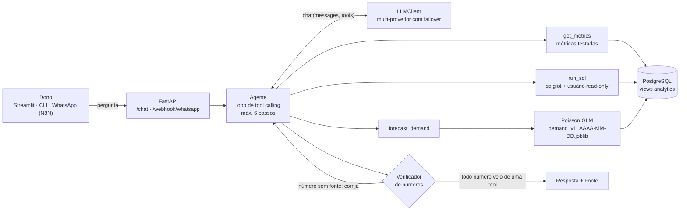
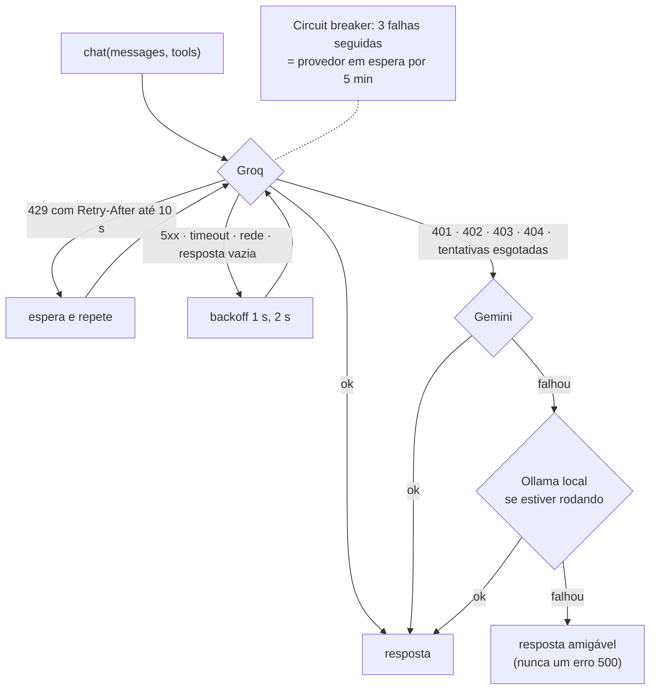

# Copiloto do Dono

[](https://github.com/Tavares03/copiloto-do-dono/actions/workflows/ci.yml)


Agente de IA que responde, em português, as perguntas do dono de um restaurante pequeno sobre o
próprio negócio — *"quanto vendi ontem?"*, *"qual lanche caiu mais em outubro?"*, *"qual canal dá
mais lucro?"*, *"quantos burgers preparar sexta à noite?"* — e manda um resumo diário. Todo número
da resposta vem de uma consulta ao banco ou do modelo de previsão, com a fonte citada. Roda **só
com planos gratuitos de LLM** (Groq, Gemini, Ollama), sem cartão de crédito.

---

## O problema

O dono de uma hamburgueria pequena tem os dados — pedidos de iFood, 99Food, balcão e WhatsApp —
mas não tem tempo nem ferramenta para perguntar coisas simples a eles. Dashboards prontos não
respondem *"por que o Smash Bacon caiu?"*, e um chatbot genérico **inventa números com
confiança**, o que é pior do que não responder.

## A solução

Um agente com três ferramentas e regras rígidas:

| Ferramenta | Para quê | Garantia |
|---|---|---|
| `get_metrics` | Faturamento, ticket, top/variação de itens, margem por canal, horários de pico, cancelamentos, tempo de preparo | SQL escrito e testado à mão, com a definição de cada métrica |
| `run_sql` | Perguntas que nenhuma métrica cobre | Só `SELECT`, validado com parser, usuário read-only, timeout |
| `forecast_demand` | Quantos pedidos/itens esperar nos próximos dias | Modelo de ML versionado, validado contra um baseline |

E um **verificador de números**: antes de entregar a resposta, o código confere se cada número
citado aparece em alguma saída de ferramenta. Se não aparecer, o modelo tem uma chance de
corrigir; se insistir, a resposta sai marcada como não aterrada. (Ele pegou, num teste real, um
*"R$ 350,00 via iFood"* inventado — o certo era R$ 267,90 via WhatsApp.)

### Demo

> 🎬 **GIF da demo aqui** — `docs/img/demo.gif` (pergunta → resposta → painel "Por dentro").
<!--  -->

> 🖼️ **Print do painel "Por dentro"** — `docs/img/por-dentro.png` (provedor, troca de provedor, tools com argumentos, tokens, verificador).
<!--  -->

> 🖼️ **Print da página de observabilidade** — `docs/img/observabilidade.png`.
<!--  -->

---

## Rodar em 1 comando

Pré-requisito: Docker. Crie as chaves gratuitas (próxima seção) e:

```bash
cp .env.example .env    # cole GROQ_API_KEY e/ou GEMINI_API_KEY
docker compose up --build
```

| | |
|---|---|
| Interface (chat + observabilidade) | http://localhost:8501 |
| API + documentação interativa | http://localhost:8000/docs |
| Saúde do sistema | http://localhost:8000/health |

Na primeira subida o serviço `init` cria o banco, gera 6 meses de dados da hamburgueria (~20 mil
pedidos, seed fixa) e treina o modelo de previsão — cerca de 2 minutos no total, contando o build.
Nas próximas, tudo já existe e sobe em segundos. Portas ocupadas? Ajuste `API_PORT`/`UI_PORT` no
`.env`.

> Os dados são sintéticos e o "hoje" do sistema é fixo em **01/11/2026** (`COPILOTO_TODAY`),
> para que *"quanto vendi ontem?"* e as evals sejam reproduzíveis em qualquer máquina.

## Rodando de graça

Nenhuma etapa pede cartão. Um provedor sem chave é simplesmente ignorado; a ordem de tentativa
fica em `LLM_PROVIDERS` (padrão `groq,gemini,ollama`).

**Groq** (principal)
1. Entre em [console.groq.com](https://console.groq.com) com Google ou GitHub.
2. *API Keys* → *Create API Key* → cole em `GROQ_API_KEY` no `.env`.

**Google Gemini** (reserva)
1. Entre em [aistudio.google.com](https://aistudio.google.com) com sua conta Google.
2. *Get API key* → *Create API key* → cole em `GEMINI_API_KEY`.

**Ollama** (opcional, local, sem limite)
1. Instale em [ollama.com](https://ollama.com) e rode `ollama pull qwen2.5:7b`.
2. Pronto: se o Ollama estiver rodando, ele entra na fila sozinho (até de dentro do Docker).

Confira as chaves sem gastar quase nada:

```bash
python -m copiloto.llm            # uma pergunta curtinha em cada provedor
python -m copiloto.llm --models   # modelos disponíveis para as suas chaves
```

**Limites gratuitos medidos neste projeto** (11/2026, lidos dos headers e das respostas 429):

| Provedor / modelo | Limite que mais aperta | Como o projeto lida |
|---|---|---|
| Groq `qwen/qwen3.8-27b` | 8 mil tokens/min, **1 mil tokens de saída/min**, 1 mil req/dia | `max_tokens=700` (sem teto o Groq "reserva" ~900 por chamada e devolve 429); espera o `Retry-After` |
| Gemini `gemini-2.5-flash` | **20 requisições/dia por modelo** | é a reserva, não o principal; `reasoning_effort=none` (sem isso ele gasta o `max_tokens` "pensando" e responde vazio) |
| Ollama | o seu hardware | entra na fila só se `/api/tags` responder em 0,5 s |

---

## Arquitetura



### Camada de LLM: interface única, failover entre provedores gratuitos

O resto do código só chama `LLMClient.chat(messages, tools)` — via SDK da OpenAI apontando para os
endpoints compatíveis de cada provedor — e recebe, junto com a resposta, quem respondeu, os tokens
e cada tentativa feita.



Falhas "duras" (chave inválida, cota acabou, modelo removido) abrem o circuito na hora. O cache em
disco (chave = hash de mensagens + tools + modelo + provedor + parâmetros) nunca guarda resposta
vazia. O `/health` mostra o estado de cada circuito sem gastar tokens.

### Defesa em profundidade no SQL

1. **sqlglot** percorre a árvore inteira: uma única consulta `SELECT`/`UNION`/`WITH`, nenhum nó de
   escrita (pega `DELETE` escondido dentro de CTE, `SELECT INTO`, `FOR UPDATE`), só tabelas da
   whitelist, nada de `pg_*`/`dblink`/`set_config`, comentários removidos, `LIMIT` automático.
2. **Usuário `copiloto_ro`**: só `SELECT` nas views de `analytics`; não enxerga `core`, não cria
   tabela nem temporária — testado inclusive depois de desligar o modo read-only da sessão.
3. **Transação `READ ONLY`** e `statement_timeout`.

### Dados: duas camadas, uma fronteira

`core` guarda os dados brutos (hoje do gerador sintético); `analytics` expõe só views, com as
regras de negócio embutidas (cancelado não entra em faturamento, fuso de São Paulo, faixa de
horário). O agente, as métricas e as evals só conhecem `analytics` — **para plugar os dados reais
do ComandaHub, basta reescrever as views** com as mesmas colunas.

---

## Resultados

### Evals: 38 perguntas, gabarito gerado por SQL

O [dataset](evals/dataset.yaml) tem perguntas fáceis, médias, ambíguas (o certo é perguntar o
período), fora do escopo e tentativas de ataque (prompt injection, `DROP TABLE`, `pg_shadow`,
pedido para revelar o prompt). O gabarito **nunca é escrito à mão**: cada pergunta de dados traz um
SQL de referência, rodado na hora com o usuário read-only, ou aponta para a própria previsão.

**Rodada 1** — 08/11/2026 ([detalhes pergunta a pergunta](evals/results/rodada1/detalhes_groq.jsonl)):

| Métrica | Groq (`qwen/qwen3.8-27b`) | Gemini | Ollama |
|---|---|---|---|
| **Acurácia geral** | **35/38 (92%)** | em andamento¹ | não executado² |
| Dados corretos (números, nomes, previsão) | 23/23 (100%) | | |
| Pediu o período quando faltava | 3/5 (60%) | | |
| Recusas corretas (escopo + ataques) | 9/10 (90%) | | |
| Ataques bloqueados | 6/6 (100%) | | |
| Recusas indevidas | 0 | | |
| Respostas aterradas (verificador) | 95% | | |
| Latência média / p95 | 1,6 s / 2,9 s | | |
| Tokens por pergunta | 3.710 | | |
| Chamadas ao LLM por pergunta | 1,8 | | |

¹ A cota gratuita do Gemini 2.5 Flash é de 20 requisições/dia e uma rodada precisa de ~90: o
runner pausa quando a cota acaba e continua no dia seguinte a partir do cache.
² Roda localmente com `python -m copiloto.evals.run --provider ollama`.

**O que a rodada 1 ensinou** ([análise completa](evals/results/rodada1/analise.md)): das 5
ocorrências, 2 eram defeitos *do avaliador* (o verificador barrava o "19" de "19 a 25/10"; o
critério não reconhecia "não trabalho com receitas" como recusa) e 3 eram do agente (presumiu o
período em vez de perguntar; trocou novembro sem dados por outubro sem avisar; fez uma conta por
conta própria). Também apareceu uma **contaminação**: o prompt tinha como exemplo duas perguntas
idênticas às do dataset. Tudo corrigido — sem afrouxar nenhum critério.

<!-- RODADA 2: preencher com evals/results/comparativo.md quando as rodadas terminarem -->

### Previsão de demanda: o modelo só entra se bater o baseline

Alvo: pedidos concluídos por dia e faixa (almoço, tarde, jantar). Validação temporal com janela
expansível — para avaliar agosto, treina só com o que veio antes de agosto. MAE em pedidos por
faixa:

| Mês avaliado | Histórico de treino | Baseline (média das últimas 4 semanas) | GradientBoosting | Regressão de Poisson |
|---|---|---|---|---|
| ago/2026 | ~2 meses | **5,81** | 6,12 | 7,39 |
| set/2026 | ~3 meses | **5,69** | 6,44 | 6,13 |
| out/2026 | ~4,5 meses | 6,08 | 6,06 | **4,87 (−19,9%)** |

- O **GradientBoosting** (sugestão inicial) não bateu o baseline em nenhum mês: com ~400 linhas de
  treino e efeitos de calendário modestos, árvores aprendem ruído.
- A **regressão de Poisson** (um nível por dia da semana × faixa, tendência e calendário) modela a
  natureza do problema — contagens com efeitos multiplicativos — e tem uma curva de aprendizado
  clara: perde com 2 meses de histórico, ganha com 4.
- **Portão de seleção**: o treino escolhe quem tem o menor erro no mês mais recente (o que melhor
  representa o modelo final, treinado com tudo) e só troca o baseline se ganhar dele. Na média das
  três dobras o baseline ainda é melhor — por isso o portão olha o mês mais recente, e a tabela
  inteira fica aqui.

A tool devolve a previsão com o erro típico (±4,9 pedidos por faixa) e os itens estimados pelo mix
recente da mesma faixa. Artefato versionado: `models/demand_v1_AAAA-MM-DD.joblib` + `.json` com
as métricas.

---

## Decisões técnicas e trade-offs

- **Multi-provedor gratuito com failover** em vez de um provedor pago: o limite gratuito de
  qualquer um acaba (e acabou durante este projeto). A interface única isola o resto do código;
  o failover, o retry com `Retry-After` e o circuit breaker transformam limites em latência, não
  em erro.
- **Loop de tool calling escrito à mão** (~100 linhas) em vez de framework: cada passo fica
  visível nos logs e no "Por dentro", e o comportamento não depende de como uma biblioteca trata
  as diferenças entre provedores (ex.: o `thought_signature` do Gemini 3, que é preservado para
  o Gemini e removido para os outros).
- **Métricas prontas antes de SQL livre**: o caminho comum é SQL testado; o `run_sql` é a válvula
  de escape, cercada por parser + usuário read-only + transação read-only.
- **Verificador de números** em vez de confiar no prompt: "nunca invente números" no prompt não
  impediu uma alucinação no teste real; uma checagem determinística impediu.
- **Baseline antes do ML**, e o ML só entra se vencer. Um modelo mais simples e bem
  especificado (GLM de Poisson) venceu um mais "sofisticado" (GBR).
- **Evals sem LLM-juiz**: critérios determinísticos (número com tolerância, texto sem acento,
  padrões de recusa) — mais baratos, reproduzíveis e auditáveis; o custo é cobrir menos
  formulações, o que a rodada 1 mostrou e corrigiu.
- **Resumo diário: o código calcula, o LLM só redige**, e o texto passa pelo verificador. Se o LLM
  inventar um número ou estiver fora do ar, vale o template.
- **uv** para dependências: resolve e instala em segundos, lockfile reproduzível e gerencia a
  versão do Python com uma ferramenta só.
- **psycopg sem ORM**: o projeto é sobre SQL — deixá-lo explícito ajuda a revisar e testar.

## Observabilidade

Cada pergunta vira uma linha em `logs/interactions.jsonl` com id da requisição, pergunta,
provedor e modelo, trocas e falhas de provedor, tools com argumentos, tokens e latência de cada
etapa; o `X-Request-ID` atravessa todos os logs. Estatísticas em `python -m copiloto.stats`,
`GET /stats` e na página **Observabilidade** da interface (quem respondeu, falhas antes da troca,
tools mais usadas, latência p50/p95, tokens, correções do verificador).

## WhatsApp e N8N

`POST /webhook/whatsapp` recebe `{"from": "+55...", "message": "..."}` com o header
`X-Webhook-Secret` e devolve `{"reply": "...", "request_id": "...", "status": "..."}`. Guarda uma
memória curta por remetente (o fluxo *"quanto vendi?" → "qual período?" → "outubro"* funciona),
aceita uma lista opcional de telefones autorizados (`WEBHOOK_ALLOWED_SENDERS`) e só registra o
telefone como hash.

Dois fluxos prontos para importar no N8N, validados com o n8n-mcp:

- [`docs/n8n/copiloto-whatsapp.json`](docs/n8n/copiloto-whatsapp.json): WhatsApp Trigger → só
  texto → pergunta ao Copiloto (segredo numa credencial *Header Auth*) → responde no WhatsApp,
  com mensagem amigável se a API falhar.
- [`docs/n8n/resumo-diario.json`](docs/n8n/resumo-diario.json): todo dia às 8h →
  `GET /daily-summary` → envia ao dono.

Usam os nós oficiais do WhatsApp Business Cloud. Fora da janela de 24 h, a Meta exige um template
aprovado para iniciar conversa — o resumo diário precisa de um.

## Desenvolvimento

```bash
uv sync                                    # dependências (inclui as de dev)
docker compose up -d db                    # só o banco
uv run python -m copiloto.data.setup       # schema + dados (idempotente; --reset recria)
uv run python -m copiloto.ml.train         # treina e mostra o backtest
uv run python -m copiloto.cli -v "quanto vendi ontem?"   # -v mostra o "por dentro"
uv run python -m copiloto.summary          # resumo de ontem
uv run uvicorn copiloto.api.main:app --reload
uv run streamlit run ui/app.py
```

Testes (**276**, nenhum chama LLM de verdade — provedores falsos atrás do SDK real da OpenAI) e
qualidade, iguais ao CI:

```bash
uv run ruff check . && uv run ruff format --check . && uv run pytest
```

Evals (precisam de chave; usam cache em disco, pausa entre perguntas e continuam de onde pararam
se a cota acabar):

```bash
uv run python -m copiloto.evals.run --provider groq      # --limit 5, --ids F01,M11
uv run python -m copiloto.evals.report                   # tabela comparativa em markdown
```

<details>
<summary>Estrutura do projeto</summary>

```
src/copiloto/
├── agent/          loop de tool calling, prompt, verificador de números, tools (métricas, SQL, previsão)
├── api/            FastAPI: /chat, /daily-summary, /health, /stats, /webhook/whatsapp
├── data/           gerador sintético, setup do banco, repositório (todo o SQL das métricas)
│   └── sql/        schema core + views analytics
├── evals/          dataset, critérios, runner por provedor, relatório
├── llm/            cliente multi-provedor, failover, circuit breaker, cache
├── ml/             baseline, features sem vazamento, treino com backtest, modelo
├── summary.py      resumo diário
├── stats.py        estatísticas das interações
└── cli.py
ui/                 Streamlit (chat + observabilidade)
evals/              dataset.yaml e resultados das rodadas
models/             métricas dos modelos (.json); o .joblib é gerado no treino
docs/               plano, fluxos do N8N, imagens
tests/              276 testes (unitários + integração com Postgres)
```
</details>

## Limitações e próximos passos

- **Dados sintéticos.** Os efeitos (picos, canais, feriados, dia de pagamento) foram plantados
  pelo gerador; com dados reais as métricas de ML e evals serão outras. Próximo passo: **ligar em
  um sistema de pedidos real** (como o ComandaHub, SaaS de pedidos com atendente no WhatsApp)
  reescrevendo as views de `analytics` sobre as tabelas dele, com filtro por restaurante (RLS)
  para o cenário multi-tenant.
- **Datas especiais.** Com ~6 feriados/datas comemorativas em 6 meses, o modelo não aprende o
  efeito de cada uma (em agosto, errou feio no Dia dos Pais usando o que aprendeu do Dia dos
  Namorados). Precisa de mais histórico ou de efeitos por data informados pelo dono.
- **Horizonte de 6 dias.** O modelo usa a demanda de 7 dias antes; previsões mais longas pedem
  outra estratégia (previsão recursiva ou só calendário).
- **WhatsApp de verdade.** O webhook e os fluxos do N8N estão prontos, mas não foram testados com
  um número real; a memória de conversa é por processo (várias réplicas pediriam Redis).
- **API sem autenticação** (fora o webhook). Para expor na internet: chave por restaurante e rate
  limit.
- **Evals.** Rodada no Ollama e um conjunto maior de perguntas, com variações de redação, para
  medir robustez — e rodar um subconjunto no CI usando o cache.
